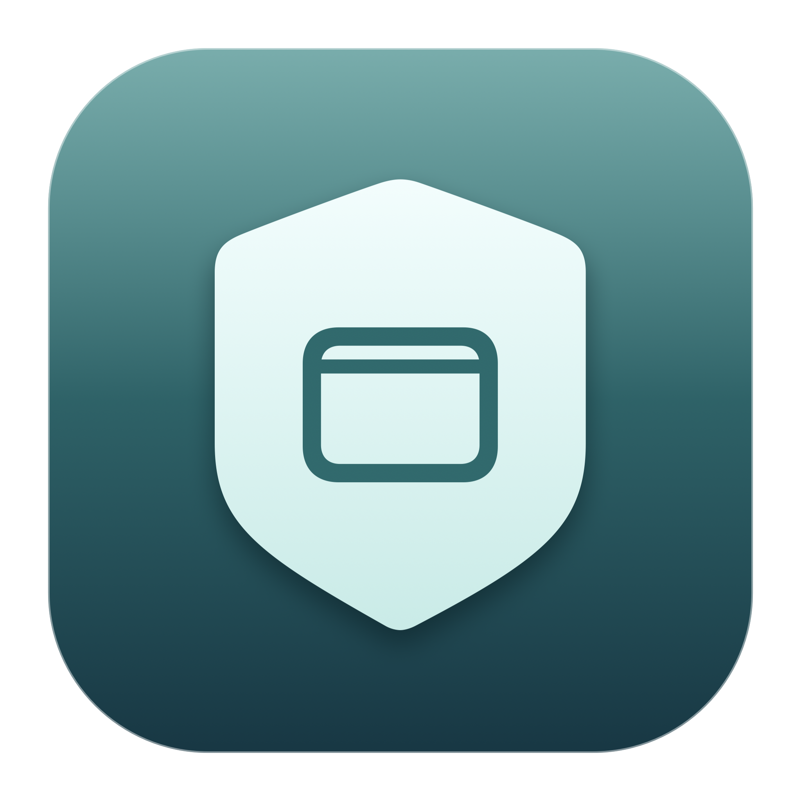

# Menu Bar Guard

<p align="center"></p>

Free Mac app for MacBooks with a notch. When you have so many menu bar icons that some hide
behind the notch (the little double arrow), Menu Bar Guard politely quits the lowest-priority
apps **you allow**, and brings them back when there is room again.

- **Priority list.** Drag apps into order. Top = keep longest. Lock an app (padlock) to never touch it.
- **Opt-in.** Nothing is ever closed unless you switch on *Auto-quit* for that app.
- **Polite.** Uses a normal "quit" request, never force-quit. Apple's own icons (Wi-Fi, battery, clock) are never touched.
- **Gets them back.** Apps it closed are listed in the panel with a Restart button, and restart on their own when space frees up.
- **Log.** Every action is written in the Log tab.

## How it knows

It asks each app where its menu bar icons are (macOS Accessibility). It compares the left-most icon
with the right edge of the notch. Hidden icons, or less than 40 pt of free space (adjustable), count as "full".
Menu Bar Guard needs **Accessibility** permission for this. It only reads icon positions; nothing is recorded or sent.

## Install

Download `MenuBarGuard.dmg` from the latest release, drag to Applications, open, follow the three welcome screens.

## Build

```bash
./build.sh            # builds build/MenuBarGuard.app (Command Line Tools only)
swiftc -swift-version 5 Planner.swift tests/logic_test.swift -o /tmp/t   # rename logic_test.swift to main.swift first
```

Requires macOS 14+, Apple silicon. MIT licence.
